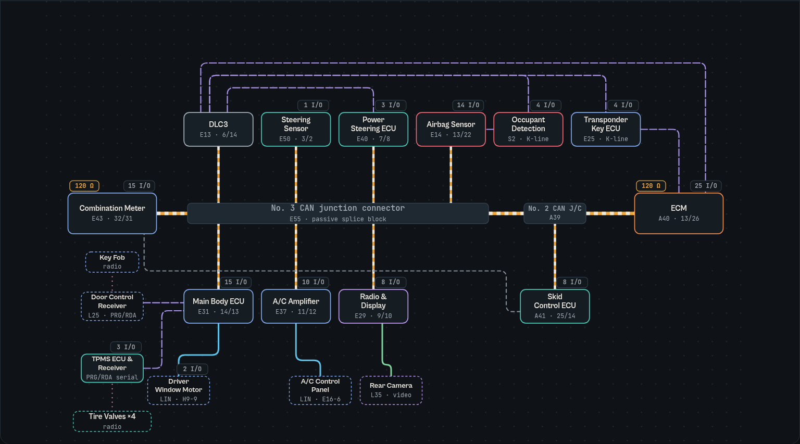
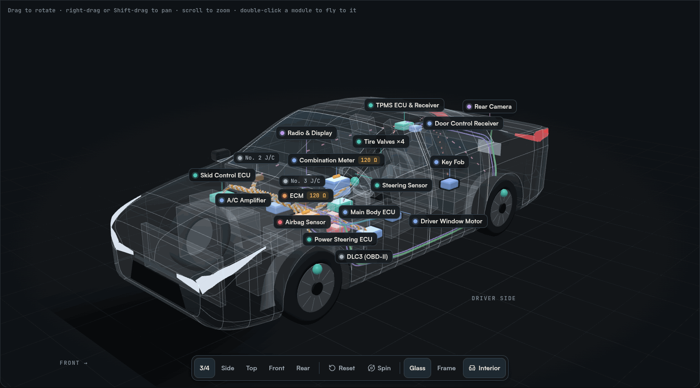
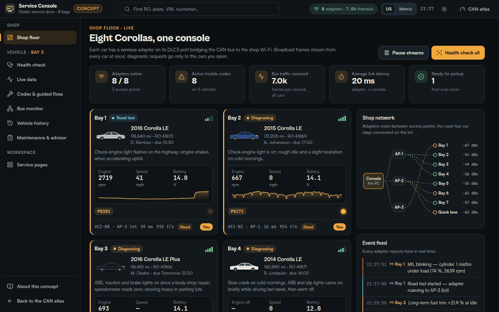

# 2016 Toyota Corolla LE — CAN Network Atlas

An interactive, presentation-ready map of the in-vehicle network in a 2016 Toyota Corolla LE (E170): the CAN "V bus", its junction connectors and terminators, every ECU on the bus, the LIN sub-buses and serial links hanging off the gateways, and the sensors, switches, actuators and displays wired to each module.

**Live site: [jacklewis0221.github.io/corolla-2016-can-topology](https://jacklewis0221.github.io/corolla-2016-can-topology/)**

It is a static React site with two pages — the atlas and a [dealership service console concept](https://jacklewis0221.github.io/corolla-2016-can-topology/service-tool.html). There is no backend, no storage and no tracking — `npm run build` produces a folder you can host anywhere.





## What is inside

| Section | What it shows |
| --- | --- |
| **Network** | Schematic of every module and data wire, morphing into an in-car view with positions from Toyota's parts-location drawings. Click a module for its role, connector pins, wire colors, wired I/O, CAN IDs it sends and listens for, and the DTCs others store if it goes silent. Unplug any module to see the fail-safe behavior and trouble codes across the car. Presets for the base LE, the LE Plus Driver Convenience Package (smart key, push-button start, sliding roof, navigation) and the LE Eco (Valvematic engine with its local CAN). |
| **3D car** | The same network mapped onto a 3D Corolla built to the 2016 LE's published dimensions. Drag to rotate, right-drag or Shift-drag to pan, scroll to zoom, double-click a module to fly to it; or use the 3/4, side, top, front and rear presets, a turntable spin, a glass or wireframe body and ghosted seats, dash and engine for reference. Modules keep their labels, the CAN V bus is drawn as a twisted pair along a harness route, and selecting, unplugging and broadcasting work the same as in the 2D views. Keyboard: arrows orbit, Shift + arrows pan, + / − zoom, 1–5 presets, 0 resets. |
| **Scenarios** | Ten step-through stories — starting the engine, shifting into reverse, opening a door, A/C request, a skid, EPS assist, low tire pressure, the seat-belt reminder, a scan tool session and the LE Eco local bus — with animated frames on the right wires and the decoded payload for each step. |
| **Frame lab** | Move a slider and watch the physical value become raw bits, Toyota's big-endian byte layout and checksum, a full CAN frame with CRC-15 and bit stuffing, and the CANH/CANL waveform. Includes an arbitration race between three real IDs and a LIN frame for comparison. |
| **Messages** | Searchable dictionary of 81 CAN identifiers with Toyota frame names, senders (with the basis for each attribution), signal layouts and consumers. |
| **Diagnostics** | DLC3 pinout, scan-tool request/response addresses, an interactive resistance check across pins 6 and 14 for a healthy bus and seven wiring faults, and Toyota's fail-safe chart. |
| **In the service bay** | A preview of the service console page: how a wireless adapter on the DLC3 port would reach the shop's console, the three access levels, and links into each console view. |
| **Sources** | Every Toyota document, community database and reference used, with links. |

## Service console (concept)

**[Open the service console](https://jacklewis0221.github.io/corolla-2016-can-topology/service-tool.html)** — `service-tool.html`



A theoretical desktop tool for a Toyota dealership's service drive. It is a design study, not a Toyota product; Toyota's real dealer software is [Techstream](https://techinfo.toyota.com/techInfoPortal/staticcontent/en/techinfo/html/prelogin/docs/tsliteflyertinfo.pdf).

| View | What it does |
| --- | --- |
| **Shop floor** | Eight E170 Corollas streaming at once over CAN-to-Wi-Fi adapters (one per car on the DLC3 port, three shop access points): live engine, speed and battery readings, trouble codes, adapter signal and latency, an access-point map and an event feed. |
| **Access levels** | Each adapter is listen-only by default (decodes broadcast frames, never transmits). A read session sends OBD-II requests to 0x7DF / 0x7E0 for values that are not broadcast. Exclusive control (active tests, clearing codes, registering tire sensors) belongs to one technician at a time, with an in-page hand-off dialog. |
| **Health check** | Scans every module on the atlas's CAN V bus drawing (green when it answers, red when it stays silent), lists each module's diagnostic address and where that address comes from, and shows the warning lamps the meter is lighting. |
| **Live data** | A 51-item data list; broadcast and requested values are labeled as such, up to four are charted with Toyota's specified ranges shaded where the repair manual gives them, and snapshots work like a manual freeze frame. |
| **Codes & guided fixes** | Six trouble codes (P0301, P0171, U0129, C2123/23, B1423/23, C1241), the console's ranked guess at the likely cause, and step-by-step procedures built from the repair manual's inspection steps and specified values; measurements are recorded and judged against spec. |
| **Bus monitor** | Raw frames by ID or as a trace, pause and filter, a bit-grid decode using the atlas's message dictionary, and a callout when an expected module's IDs stop arriving. Each frame links back to the atlas frame lab or message dictionary. |
| **Vehicle history** | Vehicle record, warranty and ToyotaCare coverage computed from the in-service date and odometer, odometer over time, past service visits and today's console log. |
| **Maintenance & advisor** | The 2016 maintenance schedule by mileage, a multipoint inspection, an estimate the customer approves line by line, a customer-facing view and a text summary. |
| **Service pages** | Customizable pages: 14 widget types, 8 templates, drag-and-drop (mouse, touch and keyboard), resizing, and export / import as a JSON file. Pages last for the browser session only. |

**Documented vs invented.** Trouble-code definitions, inspection steps and specified values come from the repair manual; maintenance intervals and warranty terms from the [2016 Warranty & Maintenance Guide](https://assets.sia.toyota.com/publications/en/omms-s/T-MMS-16Corolla/pdf/T-MMS-16Corolla.pdf); tire pressures (32 psi cold), oil (0W-20, 4.4 qt with filter), wheel-nut torque (76 ft·lbf) and warning-lamp behavior from the [2016 owner's manual](https://assets.sia.toyota.com/publications/en/om-s/OM12J84U/pdf/OM12J84U.pdf); ToyotaCare's 2-year / 25,000-mile coverage from [Toyota Support](https://support.toyota.com/s/article/What-does-ToyotaCare-7581?language=en_US); OBD-II request addresses and PID formulas from [SAE J1979 as summarized on Wikipedia](https://en.wikipedia.org/wiki/OBD-II_PIDs); battery voltage on DLC3 pin 16 the way a [J2534 READ_VBATT](https://quantexlab.com/en/develop/j2534/pt_ioctl.html) call reads it. Every vehicle, customer, price, adapter, live value and "likely cause" percentage is invented, and frame bytes whose layout is not public are simulated. The console's About dialog lists both sides with links.

## Sources

- Toyota service information for the 2014–2015 USA/Canada Corolla, which covers the pre-facelift E170 body sold through model-year 2016 (public mirror: [ToyotaManuals n00041](https://gitlab.com/ToyotaManuals/n00041)):
  - New Car Features NM30N0U — how the multiplex, CAN and LIN systems and each body system work.
  - Electrical Wiring Diagram EM30N2U — connector pins, wire colors, junction connectors, part locations.
  - Repair Manual RM30N0U — CAN fail-safe chart, DTC tables, bus resistance checks, LIN DTCs.
- comma.ai [opendbc](https://github.com/commaai/opendbc) and [openpilot](https://github.com/commaai/openpilot) — CAN IDs recorded on a 2017 Corolla (same platform), DBC signal layouts, Toyota checksum, diagnostic addresses.
- Texas Instruments [SLOA101B](https://www.ti.com/lit/an/sloa101b/sloa101b.pdf) (CAN physical layer) and [CSS Electronics](https://www.csselectronics.com/pages/lin-bus-protocol-intro-basics) (LIN).
- [Toyota newsroom](https://pressroom.toyota.com/2016-toyota-corolla-debut/) and [Edmunds](https://www.edmunds.com/toyota/corolla/2016/review/) for 2016 trim content.
- Service console page: six repair manual RM30N0U procedures (misfire, lean/rich, skid control communication stop, low supply voltage, tire pressure transmitter, A/C pressure sensor), the [2016 Warranty & Maintenance Guide](https://assets.sia.toyota.com/publications/en/omms-s/T-MMS-16Corolla/pdf/T-MMS-16Corolla.pdf), the [2016 owner's manual](https://assets.sia.toyota.com/publications/en/om-s/OM12J84U/pdf/OM12J84U.pdf), [ToyotaCare](https://support.toyota.com/s/article/What-does-ToyotaCare-7581?language=en_US) and [maintenance plans](https://www.toyota.com/maintenance-plans/), the [Techstream Lite flyer](https://techinfo.toyota.com/techInfoPortal/staticcontent/en/techinfo/html/prelogin/docs/tsliteflyertinfo.pdf), [OBD-II PIDs](https://en.wikipedia.org/wiki/OBD-II_PIDs) and [J2534 PassThruIoctl](https://quantexlab.com/en/develop/j2534/pt_ioctl.html).
- Toyota's [2016 Corolla brochure](https://www.auto-brochures.com/makes/Toyota/Corolla/Toyota_US%20Corolla_2016.pdf) for the LE's exterior dimensions used by the 3D body (182.6 in long, 69.9 in wide, 57.3 in tall, 106.3 in wheelbase, 59.8/59.9 in track, P205/55R16 tires), cross-checked against [Edmunds' LE specs](https://www.edmunds.com/toyota/corolla/2016/st-200746659/features-specs/).

## Assumptions and limits

- **Model year.** Toyota's 2014–2015 E170 publications are used for the 2016 car, the last year of the same body. The 2016 network is assumed to match them; it has not been checked against 2016-specific manuals.
- **Configuration.** The default build is a base LE (key start, Entune Audio, no smart key). Presets add the Driver Convenience Package and the LE Eco engine. 2016 LE models do not have Toyota Safety Sense, so its radar/camera frames are excluded.
- **CAN IDs.** Toyota does not publish its message list. 76 IDs come from openpilot's 2017 Corolla fingerprint — the IDs recorded on that car's bus — with its 19 Toyota Safety Sense and pedal-adapter frames removed; 5 scan-tool request addresses come from openpilot's Corolla firmware query and late-model Toyota address list. A 2016 car may differ by a few frames. Senders are inferred either from Toyota frame-name prefixes (ENG, VSC, ACN, AVN, ABG, MET, STR) or from which ECU owns the source switch; each row says which.
- **Positions** in the in-car and 3D views are approximate. The 2D in-car view draws wires point to point; the 3D view routes them along an illustrative harness path, not Toyota's routing drawings.
- **3D body.** Overall length, width, height, wheelbase, track and tire size match the published figures; the surface is a simplified sedan shape, not a scan, and the split between front and rear overhang is estimated.
- **Timing.** Animations are slowed roughly ten-thousand-fold; a real 8-byte frame takes about a quarter of a millisecond at 500 kbit/s.
- **Service console.** A concept, not a product: the fleet, customers, prices, adapters and live values are simulated in the browser. Procedures and specifications follow Toyota's 2014–2015 E170 repair manual, the same assumption as the atlas.

This is an independent educational project. It is not affiliated with or endorsed by Toyota, and it is not a substitute for the official repair manual.

## Run it

Requires Node 20+.

```bash
npm ci
npm run dev       # local dev server
npm run build     # type-check and build to dist/
npm run preview   # serve the production build
```

The build uses relative asset paths (`base: './'`), so `dist/` works from any sub-path or static host.

## Deploy

- **GitHub Pages:** `.github/workflows/deploy.yml` builds and publishes `dist/` to the live site on every push to `main` (Pages source: "GitHub Actions"). For a fork, enable Pages with "GitHub Actions" as the source.
- **Any static host** (Vercel, Netlify, S3, an internal server): upload `dist/`.

## Project layout

```
index.html          the atlas
service-tool.html   the service console concept
src/
  data/        nodes, edges, messages, scenarios, diagnostics and sources — all facts live here
  lib/         CAN encoding (signals, Toyota checksum, CRC-15, bit stuffing), geometry, models, hooks
  components/  Diagram (SVG), Topology, Car3D, Inspector, Scenarios, FrameLab, Arbitration, LinFrame,
               MessageTable, Diagnostics, Hero and page chrome
  three/       3D view: car dimensions, procedural body and cabin, module placement and harness
               routing, and the three.js scene (camera, controls, labels, traffic)
  styles/      design tokens (dark and light themes) and component styles
  tool/        the service console: data/ (fleet, signals, ECUs, maintenance, procedures), sim/ (in-browser bus and
               sensor simulation), ui/ (charts, bus diagram, tests), views/ (one file per screen) and tool.css
```

Built with React 19, TypeScript, Vite and three.js (loaded only when the 3D view is opened); the service pages use dnd-kit for drag-and-drop. Fonts: Cabinet Grotesk and Satoshi (Indian Type Foundry, free license), JetBrains Mono (OFL).
